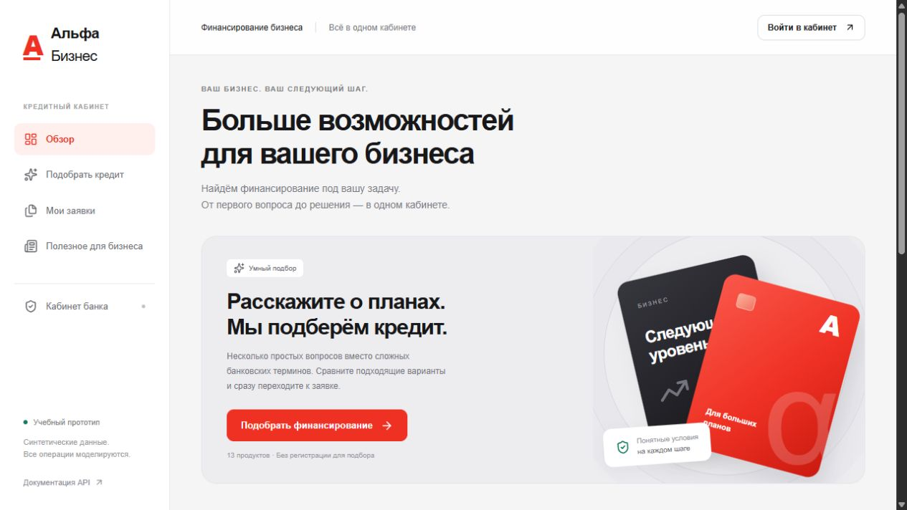

# Альфа • Кредитный кабинет

Работающий прототип кредитного конвейера для малого бизнеса: подбор по потребности, заявка, оценка риска, рабочее место аналитика, запрос сведений, предложение условий и моделирование подписи/выдачи. Веб-интерфейс на русском языке в красно-белой стилистике Альфа-Банка.

Учебный проект хакатона. Все данные синтетические. Реальных проверок ФНС/БКИ, юридической подписи и движения денег нет. Ставки и расчеты демонстрационные; подбор не гарантирует одобрения.



[](https://uk-web.ru)


## Быстрый запуск

Нужны Docker Engine / Docker Desktop с Linux containers и Docker Compose v2, интернет для первой загрузки образов и npm-пакетов. Рекомендуется 4 CPU, 6 ГБ свободной RAM и 5 ГБ диска. После сборки работа не требует внешних API или API-ключей.

Из корня репозитория:

```sh
docker compose up --build -d --wait
```

- Кабинет: http://localhost:3000
- Swagger: http://localhost:4000/api/docs
- OpenAPI JSON: http://localhost:4000/api/docs-json
- Проверка готовности: http://localhost:4000/ready

Конфигурация имеет локальные демонстрационные значения по умолчанию. Для изменения портов и секретов скопируйте `.env.example` в `.env` до первого запуска. Внешний хостинг в эту поставку не входит.

| Роль | Телефон | Пароль |
|---|---|---|
| Предприниматель | +79990000001 | AlfaDemo2026! |
| Кредитный аналитик | +79990000002 | AlfaDemo2026! |

Seed выполняется при старте, повторный запуск сохраняет существующие заявки. Для публичного развертывания смените `JWT_SECRET`, пароли и отключите `SEED_DEMO`; Демонстрационные учетные данные намеренно публичны.

```sh
docker compose ps
docker compose logs --tail=100 backend
docker compose stop
docker compose up -d --wait
```

Обычная остановка сохраняет данные в named volume Postgres. Не используйте `down -v`, если хотите сохранить заявки.

## Проверка за 5 минут

1. Откройте главную и нажмите «Поможем определиться с условиями». Выберите оборудование, 3 млн ₽ и укажите среднюю месячную выручку, расходы и платежи по кредитам либо пропустите эти данные. Выберите возраст бизнеса и отсутствие собственного залога. Проверьте объяснения и ориентир срока/платежа, если данных достаточно. Заранее выбирать банковский срок не нужно.
2. Войдите как предприниматель, заполните заявку синтетическим профилем и отправьте. Откройте результат, условия, историю проверок и документы. Обновление страницы сохраняет заявку.
3. Для положительного решения примите предложение и выполните демонстрационное подписание. Статус изменится на «Средства выданы», появится соответствующая запись истории.
4. Войдите как аналитик в другой вкладке или после выхода. Разберите заявку на ручном анализе: запросите сведения с комментарием. Под клиентом добавьте текстовый демонстрационный документ и ответьте банку. Затем под аналитиком примите решение.
5. Откройте ленту, переключите отрасль и контекст заявки. Прочитайте статью целиком; набор материалов меняется по контексту.

Подробные кейсы: [docs/TEST_SCENARIOS.md](docs/TEST_SCENARIOS.md). Изменения вопросов и источники оформления: [docs/UX_REDESIGN.md](docs/UX_REDESIGN.md). Архитектура и модель данных: [docs/ARCHITECTURE.md](docs/ARCHITECTURE.md). Состояния: [docs/STATE_MACHINE.md](docs/STATE_MACHINE.md). Соответствие заданию: [docs/REQUIREMENTS.md](docs/REQUIREMENTS.md).

## API и автоматическая проверка

Контракты и примеры: [docs/API.md](docs/API.md). Импортируйте `docs/postman_collection.json` в Postman. Статический снимок `docs/openapi.json` соответствует текущей сборке; актуальный Swagger генерируется сервером.

После запуска контейнеров:

```sh
node scripts/smoke.mjs
```

Сценарий создает отдельные синтетические данные и проверяет путь заявки и защиту API. Для другого адреса передайте `API_URL`, например `http://localhost:4000` (значение по умолчанию).

## Модели

`ml/` содержит генератор синтетических данных, обучение, метрики, ограничения и уроки предыдущих проектов. Готовые артефакты риска и классификации цели включены в `server/src/ml/`; inference выполняется локально в Node.js. Стохастические синтетические исходы позволяют проверить технический ML-конвейер, но не доказывают качество на клиентах банка. Ветки продуктовых правил и допустимые статусы рассчитываются отдельным кодом.

Переобучение не требуется для запуска. Точные команды, версии Python/NumPy и разделение выборок приведены в `ml/README.md`. Ошибки / неопределенность распознавания цели требуют подтверждения пользователя, а не произвольного отказа.

## Разработка

Основной стек: Next.js + React, NestJS + Prisma, PostgreSQL, Python/NumPy для обучения. Node и ключевые зависимости зафиксированы Dockerfile и `package-lock.json` каждого сервиса. Установка воспроизводима через `npm ci`.

```sh
cd server
npm ci
npx prisma generate --schema src/prisma/schema.prisma
npm run build
npm test
```

```sh
cd client
npm ci
npm run build
```

Использованные компоненты, модели, лицензии и симуляции перечислены в [THIRD_PARTY_NOTICES](THIRD_PARTY_NOTICES). Допущения и границы MVP описаны в архитектуре и model card.

## Версия сдачи

Логическая версия: `VERSION`. Точный commit и SHA-256 файлов комплекта записываются командой `node scripts/submission.mjs` в `submission-manifest.json`. Для сдачи нужно передать проверенный commit и предоставить жюри доступ к репозиторию. Проверка инфраструктуры и сценариев зафиксирована в [docs/VERIFICATION.md](docs/VERIFICATION.md).

После коммита и генерации манифеста `python scripts/package-submission.py` собирает ZIP в `output/` и проверяет SHA-256 каждого вложенного файла. Зависимости, секреты и локальная БД в архив не включаются.
