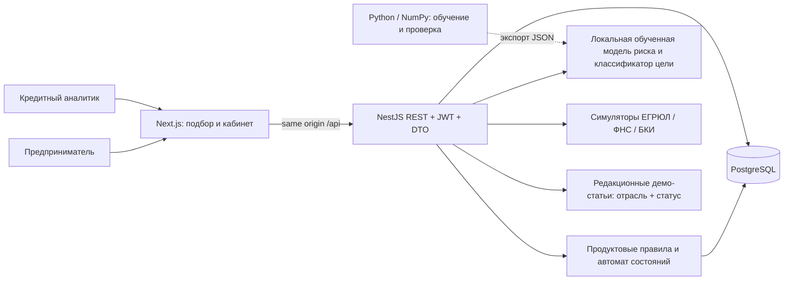
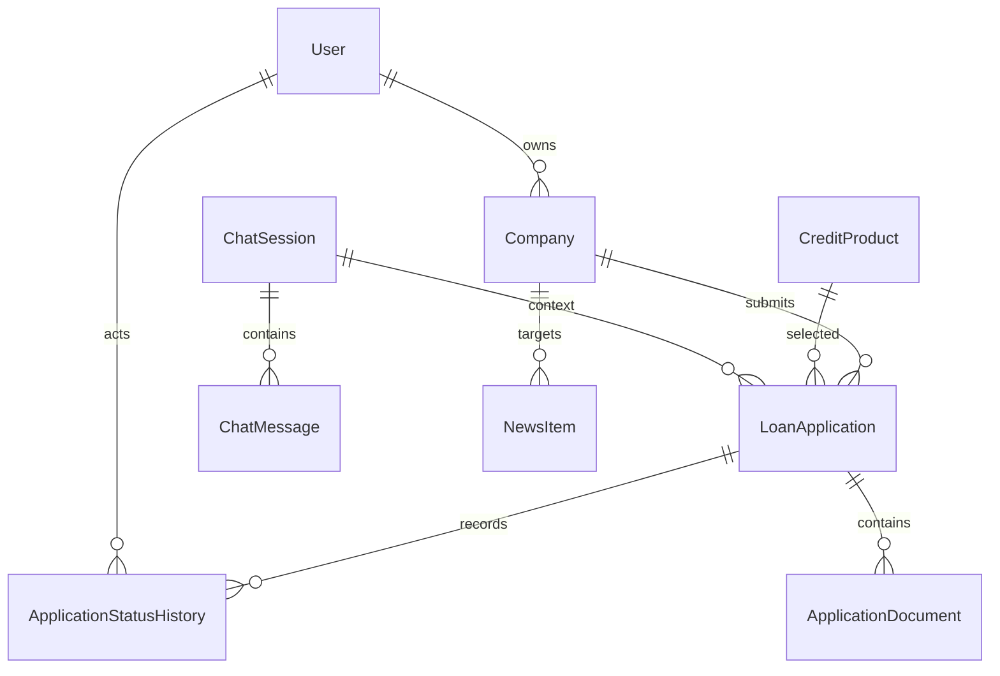

# Архитектура и границы MVP

Участники: предприниматель и кредитный аналитик. Работа проходит в веб-кабинете. Все компании, финансовые показатели, документы, внешние проверки и операции выдачи синтетические.

Браузер не подключается к БД или внешним банковским системам. Сервис не требует облачных ключей и платных API. Обучение выполняется отдельно; готовые артефакты включены в исходный код. При запросе скоринга Python не запускается.

## Кредитный процесс

1. Гость описывает потребность. Дерево Q1-Q8 фильтрует 13 вариантов по подтвержденным ограничениям, а способ выдачи и график влияют на приоритет. Гостевой черновик сохраняется при входе.
2. Пользователь входит, проверяет синтетические сведения компании и отправляет заявку. Сервер повторно проверяет входные данные, принадлежность компании и параметры продукта.
3. Симуляторы возвращают сведения реестра, налоговой и кредитной истории. Модель оценивает риск, а отдельные правила определяют результат: одобрение, иные условия, ручной анализ или отказ.
4. Аналитик разбирает заявку, запрашивает сведения и оставляет обоснование. Изменения статуса и запись истории проходят атомарно; конфликт параллельных действий отклоняется.
5. Клиент отвечает на запрос, принимает условия, выполняет демонстрационное подписание. Выдача моделируется записью состояния и документа без реального перевода средств.

## Данные и контроль доступа

Точная схема хранится в `server/src/prisma/schema.prisma`, изменения - в миграциях. Деньги хранятся в Decimal. JWT содержит идентификатор и роль; банковские методы доступны только UNDERWRITER/ADMIN, клиентские действия проверяют владельца. Пароли хешируются bcrypt. Запросы проходят whitelist-валидацию DTO. Доступ к документам также проверяется на сервере.

## Эксплуатационные решения

- Postgres использует named volume, backend/frontend имеют healthcheck и зависят от готовности предыдущего сервиса.
- Порты демо опубликованы на 127.0.0.1, БД не опубликована. Логи ограничены ротацией.
- Каждый экземпляр API не хранит заявки в памяти. БД является источником истины; состояние переживает перезапуск контейнеров.
- Production-развитие: секреты из secret manager, HTTPS, отзыв токенов, аудит с защитой от изменений, SSO/ЕСИА, object storage, очередь длительных проверок, мониторинг и резервное копирование. Эти механизмы не заявлены реализованными в MVP.

## Ограничения

Заявка обрабатывается синхронным конвейером. Синтетическая вероятность риска не валидирована на клиентах банка. Каталог следует проектной спецификации 21.10.2026; ставки и подписки в расчетах - сценарные. Редакционная лента демонстрирует персонализацию и содержит полные учебные статьи, а не актуальные сообщения государственных органов. Юридически значимой подписи и платежной интеграции нет.
