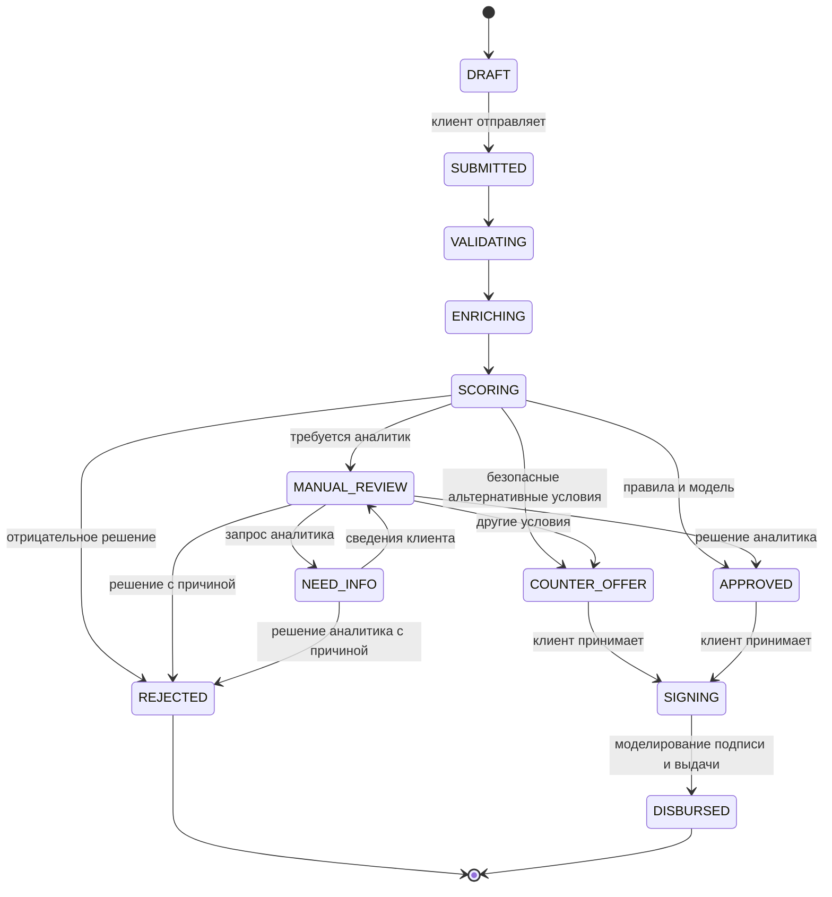

# Состояния заявки

Допустимость каждого пользовательского перехода проверяется сервером. Браузер не может произвольно выдать кредит или изменить статус. Для финальных действий проверяются текущий статус и версия записи; повторный либо конфликтующий запрос не создает вторую выдачу. История содержит автора, время, начальный и итоговый статус и комментарий.

Автоматические промежуточные состояния фиксируют выполненные проверки. При синхронной обработке они могут пройти в одном запросе, поэтому интерфейс отображает их через историю, а не искусственные задержки.

Таблица переходов в `server/src/applications/` является исполняемым источником истины; схема выше описывает основной путь MVP.
